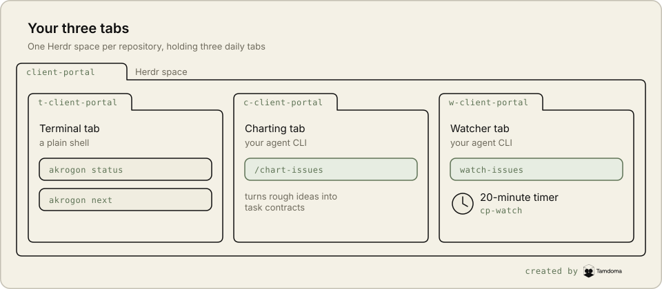

# Akrogon

Akrogon is a lightweight software factory for people who already use coding agents. You install it once per machine to serve every registered **repository** (project folder tracked by Git). You chart a request into written **contracts** (clear scope, decisions, and completion checks), a fresh **slot A (the builder)** plans and builds each task in an isolated **worktree** (a separate working copy on its own Git branch), a fresh **slot B (the reviewer)** reviews independently and repairs most findings, and the `akrogon` command runs your checks and merges the tested changes onto your **default branch** (your main live code).

It fits technical operators, agencies, and teams already running a coding agent CLI (command-line tool, such as Claude Code, Codex, agy, or pi) who want a repeatable path from request to merged code without babysitting every turn. You decide what to build and when to start it; Akrogon tracks where each task stands in plain-text files and moves work between agent terminals inside **Herdr** (your terminal workspace). Akrogon does not decide your product strategy, and it does not deploy your app.

## Guide

Read the 12 guide pages in order, or open [Docs home](docs/README.md) for the full chapter index, occasional tools, and reference shelf.

### 1. Set up

1. [Install Akrogon](docs/guide/01-install.md): check your machine, write the one-per-machine config, and run the installer.
2. [Set up a repo](docs/guide/02-set-up-a-repo.md): register a repository with `/init-akrogon`, add its two-letter terminal prefix, and set up its codebase map.
3. [Your three tabs](docs/guide/03-your-three-tabs.md): create the repository's Herdr space and your daily terminal (`t-`), charting (`c-`), and watcher (`w-`) tabs.

### 2. Charting

4. [A charting session](docs/guide/04-a-charting-session.md): turn a rough idea or bug report into settled decisions in the `c-` tab with optional consultant agents.
5. [Signposts and the needs sheet](docs/guide/05-signposts.md): set priorities, hard limits, chart order, and human-only keys or approvals once per session.
6. [Charting mode](docs/guide/06-charting-mode.md): choose who answers questions while charting (No autopilot, Semi-autopilot, or Full autopilot).
7. [Build route](docs/guide/07-build-route.md): choose who builds settled work (Direct for one small, settled change under No autopilot, or Lifecycle for fresh builder and reviewer seats).
8. [Decisions, review, and hand-off](docs/guide/08-hand-off.md): check external assumptions for real, review the task tree, and hand off contracts under `issues/open/`.

### 3. Lifecycle

9. [The lifecycle: how work runs](docs/guide/09-lifecycle.md): start handed-off tasks with `akrogon next`, follow slot A and slot B through planning, building, review, and repair, and watch progress in `akrogon status`.

### 4. Merging

10. [Merging and announcements](docs/guide/10-merging.md): how the command updates each branch onto the latest main code, runs full checks and merge safety gates, pushes tested changes without rewriting history, completes issues or epics (groups of related issues), and sends optional Discord updates.

### 5. While you are away and when work stops

11. [While you are away](docs/guide/11-while-you-are-away.md): start and stop the optional 20-minute watcher in your `w-` tab to nudge waiting tasks and investigate failures overnight.
12. [When work stops](docs/guide/12-when-work-stops.md): recover failed tasks, park issues, pause a repository, stop a task or check run, and read common command refusals.

See [Docs home](docs/README.md) for occasional tools (`akrogon sync`, `/seed-issue`, `/learn-issues`, `akrogon rollback`, and reporting commands) and the complete reference shelf.
