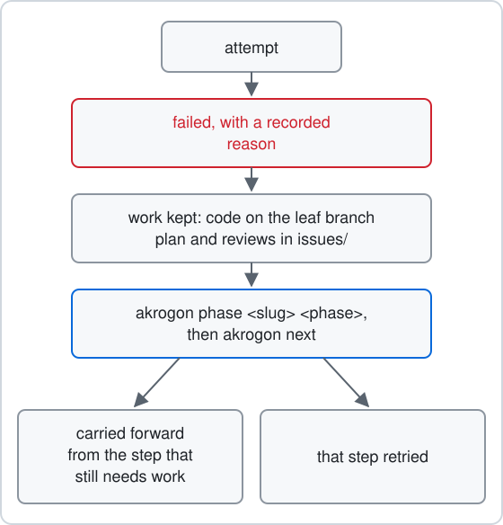

# Recovery story: a failed leaf carried forward

This story comes from [varhop](https://github.com/Tamdoma/varhop), a public Omarchy plugin that opens a prompt picker on a hotkey. Its overlay leaf failed. The operator did not throw the work away. A new leaf picked up the same code, merged it, and a second leaf finished the job and closed [varhop#1](https://github.com/Tamdoma/varhop/issues/1).

## The leaf that failed

The leaf `overlay-plugin` built the overlay itself. It went through planning, building and four repair rounds. In `check.fix`, seat A hit checks it could not pass alone: pasting into a real browser and terminal, resuming at the exact cursor spot, clicking a reset button, and approving access to a second repo. Only a person could do those.

So A stopped the leaf with `akrogon phase overlay-plugin failed --slot A --reason "..."`. The reason named the person-only items and pointed to `implementation/report.md`. The leaf moved to `failed`, and `akrogon next` gave it no more work. See [What you see](../use/when-work-fails.md#what-you-see) and the `failed` row in [Phases](../reference/state-and-phases.md#phases).

Nothing was lost. The code sat on the leaf branch at [0df6f48](https://github.com/Tamdoma/varhop/commit/0df6f48e7e8718d53eb26f8eb06ce44ae094fbf2), 33 commits ahead of main. The plan, reviews, report and check logs stayed in the leaf folder.

## Back to the chart

A live test of the overlay had also turned up problems, filed as varhop#1: the picker did not filter, there was no visible Back or Settings, variables showed as stacked form fields, and the theme was not followed. The operator opened a new chart, `overlay-rework`, with [chart-issues](../../skills/chart-issues/SKILL.md). At open, the door lists each failed leaf with its reason as work to consider.

The first fork, `disposal`, asked what to do with the failed leaf. See [Answer one fork per round](../use/plan-work.md#answer-one-fork-per-round). The options were:

- Recover the same leaf in place with `akrogon phase overlay-plugin implement`, as in [Recover a failed leaf](../use/when-work-fails.md#recover-a-failed-leaf).
- Retire the leaf and keep its code as the base of new work.
- Retire the leaf and rebuild from main.
- Drop the overlay.

Recovery in place was allowed, but it would keep `fix_rounds` at 4 and the old contract. That contract still held the checks only a person could do, so the same stop would come back. The operator picked retire and keep the code. The successor would reuse the slug `overlay-plugin`.

## Retiring the old leaf

The door moved the whole leaf folder, tracked and untracked files, out of `issues/open/` into the chart at `issues/chart/overlay-rework/archive/overlay-plugin/`. Its `state.yaml` still says `phase: failed`, with the reason. The door checked the copy and ran `akrogon status`, which no longer listed the leaf. See [Layout of issues/](../reference/files.md#layout-of-issues) and [Inspect](../reference/commands.md#inspect).

The worktree and branch `overlay-plugin` stayed where they were. The copy installed on the desktop kept working from them until the new code landed.

## The redo

The `split` fork made two leaves under a new issue, `overlay-rework`:

- `overlay-plugin` lands the existing code, plus a keyboard helper that makes the person-only checks repeatable.
- `overlay-rework`, blocked by the first, does the picker, look, editor and controls changes, and lists `Tamdoma/varhop#1` in its `sources`.

At [the handoff](../use/plan-work.md#review-the-handoff), the door wrote both leaves' files. The new `overlay-plugin` brief told A to first check that the worktree head was 0df6f48 and clean. It also asked for a table that maps every done-criterion of the archived brief to its evidence, and marks which ones now belong to `overlay-rework`. See [Leaf folder records](../reference/files.md#leaf-folder-records).

Because the slug was the same, `akrogon next overlay-plugin` found the existing worktree at the same path and reused it, with the same branch. No git step was needed. See [Run work](../reference/commands.md#run-work) and [next.ts](../../src/next.ts).

A added the helper, starting with [b61823b](https://github.com/Tamdoma/varhop/commit/b61823b7a2de57c2b99015a23c54f07ae7af32b2), and ran the live checks with it. Both seats asked for fixes in review, and after one repair round the leaf merged. Its `state.yaml` in `issues/closed/overlay-rework/overlay-plugin/` says `phase: merged` with `fix_rounds: 1`. The failed record in the chart archive is a separate folder. Both are true: the first attempt failed, and the second attempt under the same slug merged.

## The rework lands

With `overlay-plugin` merged, `overlay-rework` was free to start. Seats A and B both asked for fixes in `check.review`. After one repair round B found it ready, and the leaf merged at [0be8ca4](https://github.com/Tamdoma/varhop/commit/0be8ca43d9c88c2a98d809ef6bc7070479377b62).

That was the last leaf of the issue. The issue folder moved to `issues/closed/overlay-rework/`, and the command closed varhop#1 from the leaf's `sources`. See the `sources` row in [State fields](../reference/state-and-phases.md#state-fields).

Next: [When work fails](../use/when-work-fails.md)
