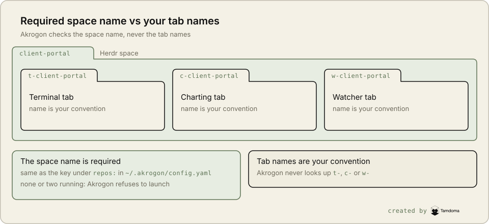
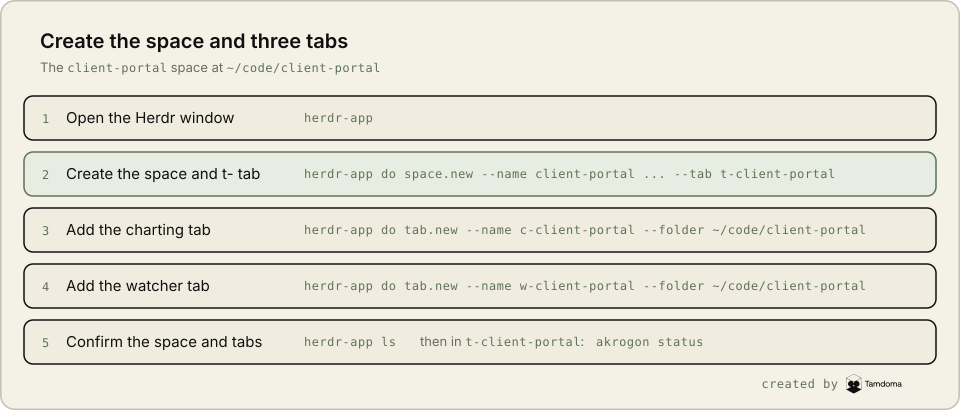
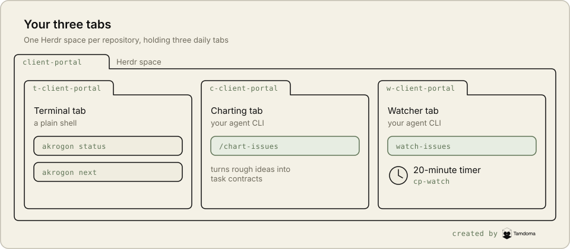

# Your three tabs

Akrogon runs inside **Herdr**, a terminal workspace split into two parts: **`herdr-app`** (the window you see) and **`herdr-core`** (`hc`, the background controller that keeps your terminals alive even if you close the window).

Each registered repository gets one Herdr **space** holding three daily tabs so your status terminal, your charting agent, and your overnight watcher stay organized and out of each other's way.

## Required space name vs your tab naming convention

Two rules separate what Akrogon enforces from what is simply your workspace habit:

- **The Herdr space name is required.** Akrogon searches your running `hc` sessions for a Herdr space whose name matches the repository's registered name in `~/.akrogon/config.yaml` verbatim (for `client-portal`, the space must be named `client-portal`). If no running session holds a space with that name, or if two running sessions both hold one, Akrogon refuses to launch seats or consultants for that repository.
- **The `t-`, `c-`, and `w-` tab names are your convention, not enforced by code.** Akrogon never looks up or requires `t-`, `c-`, or `w-` tab prefixes. Naming your three permanent tabs `t-client-portal`, `c-client-portal`, and `w-client-portal` simply keeps them recognizable beside the temporary task tabs Akrogon opens and closes while tasks run.



## Create the space and three tabs step by step

These steps set up the `client-portal` space at `~/code/client-portal`.



### 1. Open the Herdr window

Launch `herdr-app` from your app launcher or a terminal.

Expected result: The Herdr window opens and connects to your local `hc` session. Running `herdr-app ls` from any shell exits `0` instead of reporting `no Herdr window`.

### 2. Create the `client-portal` space with your terminal tab (`t-client-portal`)

```sh
herdr-app do space.new --name client-portal --folder ~/code/client-portal --tab t-client-portal
```

(You can also create the space in Herdr's sidebar, set its folder to `~/code/client-portal`, name the space `client-portal`, and rename its first tab to `t-client-portal`.)

Expected result: Herdr opens and selects a new space named `client-portal` with one shell tab named `t-client-portal` sitting in `~/code/client-portal`.

### 3. Add the charting tab (`c-client-portal`)

```sh
herdr-app do tab.new --name c-client-portal --folder ~/code/client-portal
```

Expected result: A second tab named `c-client-portal` appears inside the `client-portal` space, starting in `~/code/client-portal`.

### 4. Add the watcher tab (`w-client-portal`)

```sh
herdr-app do tab.new --name w-client-portal --folder ~/code/client-portal
```

Expected result: A third tab named `w-client-portal` appears inside the `client-portal` space, also starting in `~/code/client-portal`.

### 5. Confirm the space and tabs

```sh
herdr-app ls
```

Expected result: Lists the `client-portal` space with its three tabs (`t-client-portal`, `c-client-portal`, and `w-client-portal`) along with their terminal and pane IDs.

Switch to `t-client-portal` and run:

```sh
akrogon status
```

Expected result: Prints `Listener: live`, `client-portal`, and `no open leaves`.

If you work across multiple repositories (such as `acme-core`, `client-portal`, and `partner-hub`), repeat Steps 2 to 5 once per registered repository, naming each space after its key under `repos:` in `~/.akrogon/config.yaml`. Keep only one space with a given repository name across all running Herdr sessions.

## What runs in each tab

In daily work, **`t-` runs `akrogon status` and `akrogon next`, `c-` runs the charting agent, and `w-` runs the watcher.**



| Tab | Role | What you run here |
| --- | --- | --- |
| **`t-client-portal`** | Terminal tab | `akrogon status`, `akrogon status --charts`, `akrogon next`, `akrogon next <slug>` |
| **`c-client-portal`** | Charting tab | Your agent CLI running `/chart-issues` |
| **`w-client-portal`** | Watcher tab | Your agent CLI running `watch-issues ~/code/client-portal` (and `watch-issues stop ~/code/client-portal`) |

- **`t-` (`t-client-portal`)**: Keep this as a plain shell in `~/code/client-portal`. Use it to run `akrogon status` (to see active tasks, waiting queues, and failures), `akrogon status --charts` (to check open charts), and `akrogon next` (to start handed-off tasks or advance ready ones).
- **`c-` (`c-client-portal`)**: Start your preferred coding agent CLI here (such as `claude`, `codex`, `agy`, or `pi`) and run `/chart-issues` to turn rough ideas or bug reports into settled written task contracts (or ship one small settled change on the Direct route). When you ask the charting agent to launch consultants, it places them in panes beside this tab inside Herdr.
- **`w-` (`w-client-portal`)**: Start a coding agent CLI here before you step away or go to bed and send `watch-issues ~/code/client-portal` (in Claude Code, `/watch-issues ~/code/client-portal` is an alias). The [watch-issues](../../skills/watch-issues/SKILL.md) skill starts a 20-minute `hc` timer (`cp-watch`) that checks open tasks, advances ready ones, and handles or reports failures; send `watch-issues stop ~/code/client-portal` when you return.

## Task tabs Akrogon manages for you

When `akrogon next` starts a Lifecycle task, Akrogon opens one temporary tab inside the `client-portal` space for that task (named `<slug>`, or `<slug> failed` if it stops in `failed`) holding slot A and slot B, and closes that tab after the task merges. Leave those task tabs to Akrogon while your `t-`, `c-`, and `w-` tabs stay put.


Closing the Herdr window does not kill running terminals: `herdr-core` keeps them alive in the background, and Akrogon continues running seats headless until you reopen the window.

Previous: [Set up a repo](02-set-up-a-repo.md) · Next: [A charting session](04-a-charting-session.md)
