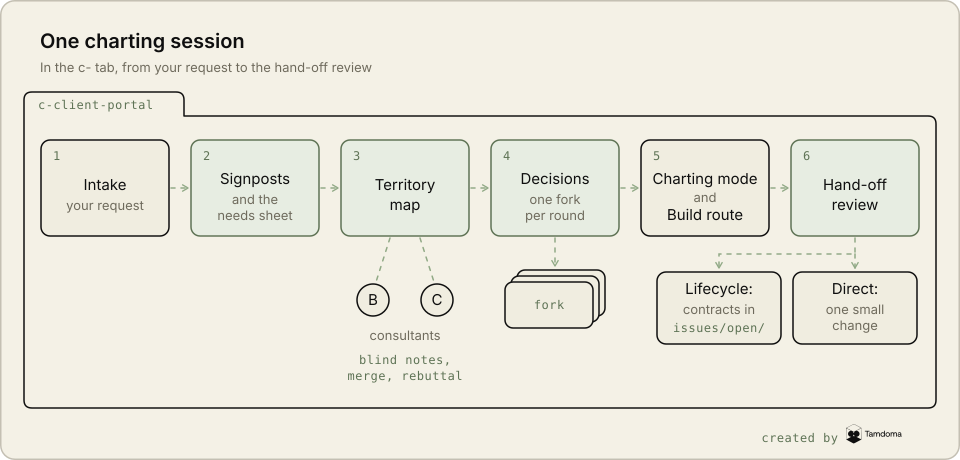

# A charting session

Charting turns a rough idea or bug report into settled written decisions before anyone writes code, so your coding agents build what you asked for instead of guessing.

This chapter follows one example job across all five pages: **adding a weekly client report export to `client-portal`**, a made-up internal reporting app your agency uses for client accounts. Every session runs the same way whether you are adding a feature, fixing a bug, or working through a queue of reports.

## Where you chart: the `c-` tab

Akrogon runs inside **herdr**, a terminal workspace that keeps your project tabs organized in one window. In daily work, each registered **repository** (the project folder where your app's code and history live) uses three tabs:

- **`t-client-portal`** (terminal tab): where you check status (`akrogon status`) and start finished work (`akrogon next`).
- **`c-client-portal`** (charting tab): where you talk to your **charting agent** and settle open questions.
- **`w-client-portal`** (watcher tab): where you turn on the background watcher when you step away or go to bed.

Those `t-`, `c-`, and `w-` tab names are your daily workspace layout inside the project's herdr space; Akrogon finds the project space by repository name rather than enforcing tab prefixes. All charting happens in the `c-` tab.

## Opening a session

Open your charting agent in `c-client-portal` and start `/chart-issues` with a plain-English request, naming any **consultants** you want beside it:

```text
/chart-issues Add a weekly client report export to client-portal. Consultants: slot B claude, claude-fable-5-2, high effort; slot C agy, neon, xhigh effort.
```

While charting, consultants sit in slots B, C, D, and a Lifecycle task later gets its own fresh slot B (the reviewer).

You can also start `/chart-issues` with no note to work through open GitHub issues. At the start of a session, the charting agent runs `akrogon pull` to mirror open GitHub issues locally into `issues/seeds/` as **seeds** (unverified reports before they are charted). It also runs `akrogon flaky` and `akrogon status` to show any flaky (intermittent) tests or tasks stopped in `failed` that you might want to bring in.

In its first reply, the charting agent confirms three things:

1. Which consultants are active (or that it is working alone).
2. Which **Charting mode** is active (`No autopilot` by default).
3. Who will answer the session's **signposts**.

## What consultants do during charting

**Consultants** are independent helper agents (`B`, `C`, `D`, and so on) that advise the charting agent while you plan. They are not the fresh **slot A (the builder)** and **slot B (the reviewer)** that later build a Lifecycle task.

You can either point the charting agent at consultant terminals you already have open, or ask it to start consultants for you inside herdr. When the charting agent starts consultants itself, it asks once for each consultant's tool (harness), model, and effort (unless you already named them), places them in a column to the right of your charting tab, and restarts them with a clean conversation whenever you enter a new chart so earlier work does not bleed in. Consultants you opened yourself are never moved, restarted, or closed by the charting agent.

Here is what consultants do during charting: **consultants map the codebase and answer each open question independently, and the charting agent merges their views.**

Specifically, for both the opening map and every open decision:

1. The charting agent and each consultant inspect the code and research the question blind, without seeing the charting agent's draft or each other's notes.
2. The charting agent merges the finished notes, tagging each point with who agreed, such as `(A,B)` or `(A,B,C)`.
3. Each consultant reads the merged notes and sends back one short rebuttal listing only where it still disagrees.
4. The charting agent presents the question to you with those remaining disagreements visible before you decide.

Consultants also review the draft task contracts as builders right before final hand-off.

## One session, step by step

Using `client-portal`'s weekly client report export, a complete charting session moves through six steps:



### 1. Intake

The charting agent creates a chart folder under `issues/chart/<slug>/` (for example, `issues/chart/weekly-client-report/`) and saves your exact request in `INTAKE.md`, kept separate from the agent's own code findings.

If an imported GitHub seed already includes an `## Operator decision (<name>, <date>)` section authored and edited only by collaborators with write or admin permission on the repository, the charting agent verifies those permissions and locks that decision at import. Locked seed decisions are shown up front and are never re-asked.

### 2. Signposts and the needs sheet

Once per session, before any code map is drawn, the charting agent asks a short round of **signposts** (your ranked priorities, hard limits, and the order of the session's charts) together with one **needs sheet** listing every API key, approval, or human-only step the session will need. See [Signposts](05-signposts.md) for the full walk-through.

### 3. Territory map

Before asking detailed questions, the charting agent and any consultants inspect the live `client-portal` codebase independently and present a **territory map**. The map shows:

- Which parts of the app the change touches (for instance, the existing report table view and the client metrics query).
- Which choices are still open and would change the outcome.
- Practical risks over the life of the feature (such as timeouts on large client accounts or broken date ranges across timezones).

Because the map checks real code first, it often removes work you did not need or reveals that one request is actually two separate jobs.

### 4. One fork per round

An open choice sharp enough to decide is called a **fork**, such as *"Which columns and date window belong in the weekly client report export?"* or *"Should the first version ship CSV only, or CSV and PDF together?"*

The charting agent works through one fork per round, starting with the answerable question that reshapes the most remaining decisions. Each round follows the same readable layout:

- **Plain context**: what the choice is and what changes based on your answer.
- **Research**: grounded evidence gathered before asking. Operator-provided notes come first, then named practitioner experience, then primary docs or live code, and model knowledge only alongside the searches that found nothing stronger.
- **Labelled options**: `1a`, `1b`, `2a`, `2b`, with one marked recommended and the trade-offs stated plainly. When options differ visually or structurally, a small text drawing sits below the options.
- **Pitfalls avoided**: the traps behind the choice and how each option prevents them.
- **Reply key and challenge check**: a short reply format (such as `1a 2b`, or any answer in your own words) plus any remaining consultant disagreements.

Not everything is clear right away. Unclear ground (such as *"reports are slow for clients with 50+ campaigns"*) stays in **Fog** inside `CHART.md` until investigation sharpens it into a fork. Work you decide not to build goes under **Off route** with its reason so no agent brings it back later.

After every answer, the charting agent saves your words and reason in `forks/<fork-slug>.md`, moves newly clear items out of Fog, and reshapes the remaining forks before asking the next round.

### 5. Charting mode and Build route

Two separate choices shape how charting and building run:

- **[Charting mode](06-charting-mode.md)** decides who answers the questions while the work is charted (`No autopilot`, `Semi-autopilot`, or `Full autopilot`).
- **[Build route](07-build-route.md)** decides who builds the work once every question is answered (`Direct` or `Lifecycle`).

### 6. Hand-off review and moving on

Once every fork is answered and Fog is empty, the charting agent runs required real-world checks on any external APIs or assumptions the work depends on, presents the **hand-off review**, and either hands off written task contracts (Lifecycle) or builds the single small change itself with consultant B reviewing (Direct). See [Hand-off](08-hand-off.md).

If your session has more than one chart, the charting agent moves straight to the next ready chart in your signposts order once the current chart hands off, closes, holds, or waits on a need or approval. On supported agent tools inside herdr (Claude, agy, Codex, and pi), it resets its own conversation between charts so context stays small while carrying forward the session's signposts.

## Where chart records live

Every chart stays saved under `issues/chart/<slug>/` even after hand-off:

- `CHART.md`: destination, chosen Build route, settled forks, open forks in order, Fog, Off route, mode history, and final status marker (`Handed off`, `Closed`, or `Held`).
- `INTAKE.md`: your original notes and any mirrored GitHub issues, kept separate from agent findings.
- `forks/signposts.md`: the session's signposts and needs sheet.
- `forks/<fork-slug>.md`: each question, its evidence, and its settled answer.
- `slots/`: blind notes, merged views, and rebuttals from consultants.
- `seats.yaml` and `USAGE.md`: recorded terminals and turn and token (AI usage) summary for the chart.

From your `t-` tab (`t-client-portal`), run `akrogon status --charts` at any time to see every chart, how many fork files have a settled answer (including `signposts.md`), how many Fog items remain, and each chart's stage.

For the full agent procedure behind every step, see [chart-issues](../../skills/chart-issues/SKILL.md).

Previous: [Docs home](../README.md) · Next: [Signposts](05-signposts.md)
