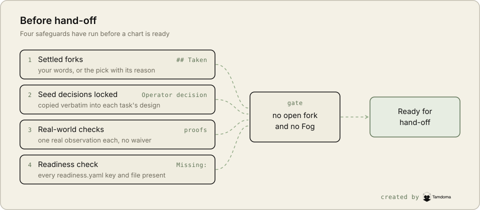
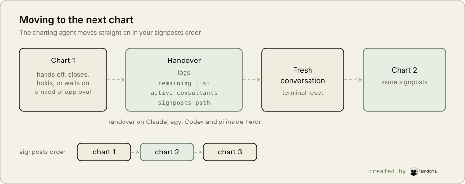

# Decisions, review, and hand-off

A clean hand-off is where charting pays off: every decision is written down, every external assumption has been checked for real, and nothing is left for a coding agent to guess.

## Before hand-off: locking decisions and checking assumptions

A chart becomes ready for hand-off only when no open fork and no **Fog** item remains. By that point, four safeguards have already run:



1. **Settled fork records**: Every fork file in `issues/chart/<slug>/forks/` holds a `## Taken` section recording either your exact words (under No autopilot) or the charting agent's recorded pick with its reason, rejected options, and any standing consultant dissent (under Semi-autopilot or Full autopilot). Excluded ideas live in `## Off route` inside `CHART.md`.
2. **Pre-decided GitHub seed decisions**: Any authorized `## Operator decision (<name>, <date>)` section imported from a GitHub seed is already locked and copied verbatim into each affected task's design. If charting finds a concrete blocking defect, such as a removed surface or an unprovable requirement, it surfaces that as a keep-or-change decision (or parks the chart under autopilot).
3. **Real-world checks (proofs)**: Before hand-off, every external API call, command-line tool call, or pre-existing assumption a task's **done-criteria** (the observable results that prove the work is finished) depend on gets one real observation using the actual identity the task will use (free checks before paid ones). There is no waiver: if something cannot be checked safely or fails its check, the charting agent cuts that unproven piece out of the contract at the hand-off review and names where it lands instead.
4. **Readiness and presence checks**: Every task gets a `readiness.yaml` file listing its required `inputs` (keys in `.env` or files), `produces`, scoped `grants` (operator-approved live-change grants plus standing permission for paid agent sessions where applicable), `retained` resources, and recorded `proofs`. Before writing any final files, the charting agent checks every draft `readiness.yaml` for missing keys or files so `akrogon status` prints any still-missing `Missing:` items and `akrogon next` holds the task until you supply them.

## What the hand-off review shows

Before writing task files under `issues/open/`, the charting agent refreshes destination GitHub issues (`akrogon pull`), checks for duplicate issues or folder collisions, runs `akrogon preflight` (which checks that your remote repository, its default branch, and your local tracking copy exist), and presents one **hand-off review** in your `c-` tab. (Under Semi-autopilot and Full autopilot, the charting agent prints the same review in its terminal and answers it itself.)


Using `client-portal`'s **weekly client report export** as an example, the review shows:

- **Task tree and split**: how the work is grouped into one issue (`ISSUE.md`) or an epic (`EPIC.md` holding multiple issues) and its individual tasks (called **leaves**). Independent outcomes run in parallel; `blocked-by` is added only when one task truly needs another to finish first:

```text
issues/open/weekly-client-report/
  ISSUE.md
  csv-export/
    brief.md          # what to build, why, and observable done-criteria
    design.md         # verbatim decisions, architecture, exclusions
    readiness.yaml    # inputs, grants, proofs
    state.yaml        # lifecycle phase and tracking (written last)
  scheduled-email/    # blocked-by: [csv-export]
    brief.md
    design.md
    readiness.yaml
    state.yaml
```

- **Scope and destination repository**: which registered repo receives the tasks (`client-portal`).
- **Settled decisions and seed decisions**: a concise recap of the choices locked into the contracts.
- **Confirmed grants**: any scoped live-account permissions (for example, your staging email send grant for `staging-reports@agency.example`).
- **Effective seats**: which models will run **slot A (the builder)** and **slot B (the reviewer)**. Only when the work is model-sensitive does the review ask whether to write a custom `slots:` block at the top of `ISSUE.md` or `EPIC.md`; otherwise it uses your repository defaults.
- **Build route choice**: either the route question (`lifecycle` or `direct`, with the charting agent's recommendation) or the one-line reason [Direct](07-build-route.md) is not offered. For `weekly-client-report`, Direct is refused because it spans two tasks and needs `POSTMARK_API_KEY` plus a staging email grant.
- **Usage summary**: turn count, operator wait time, and measured token output from `USAGE.md`.
- **Live-run estimates and pre-existing proofs**: for any task needing live runs, an estimated session count and duration; plus one line per task listing every pre-existing assumption with the proof that checked it (and anything cut).

If consultants are active, once you approve the review, the charting agent writes draft versions of every `brief.md` and `design.md` first, each consultant reviews the drafts as a builder and flags concrete gaps, and the charting agent applies those fixes before writing the final contracts into `issues/open/`. Prerequisite tasks are written before dependent tasks, and `state.yaml` is written last so Akrogon never dispatches a half-written task.

## What the charting agent hands off and what happens next


### On the Lifecycle route

**At the end of a Lifecycle chart, the charting agent hands off written task contracts under `issues/open/` for a fresh slot A (the builder) and slot B (the reviewer). It does not start the work.**

Specifically:

1. Each task folder under `issues/open/` receives `brief.md`, `design.md`, `readiness.yaml`, and `state.yaml` (starting in the initial planning phase, `plan.synthesis`), alongside `ISSUE.md` (and `EPIC.md` for multi-issue work).
2. The charting agent validates the written files with `akrogon status`, retains the original chart folder under `issues/chart/` for reference, and appends `Handed off <YYYY-MM-DD>` to `CHART.md`.
3. **No builder or reviewer starts automatically.** When you are ready to run the handed-off tasks, switch to your terminal tab (`t-client-portal`) and run:

```sh
akrogon next
```

Or run `akrogon next <slug>` to start one specific task (such as `akrogon next csv-export`). If you are stepping away or going to bed, turn on the watcher in your `w-` tab (`w-client-portal`) to start ready tasks and keep them moving while you are away.

### On the Direct route

When you choose **Direct** at an eligible hand-off review under No autopilot, the charting agent writes the single standalone task under `issues/open/<chart-slug>/`, runs `akrogon direct`, builds the change itself as slot A with consultant B reviewing as slot B, waits for the merge queue to land it (and for B's optional Discord update to finish), records the landed commit ID in `CHART.md`, and appends `Closed <YYYY-MM-DD>`.

## Moving to the next chart

As soon as one chart hands off, closes, holds, or waits on a pending need or approval, the charting agent moves straight to the next ready chart in your signposts order without making you re-select it.



On supported agent tools inside herdr (Claude, agy, Codex, and pi), switching to the next chart triggers a **handover**: the charting agent logs the remaining list, active consultants, and signposts path, resets its own terminal into a fresh conversation, and resumes on the next chart with the same session signposts intact.

Previous: [Build route](07-build-route.md) · Back to [Docs home](../README.md)
