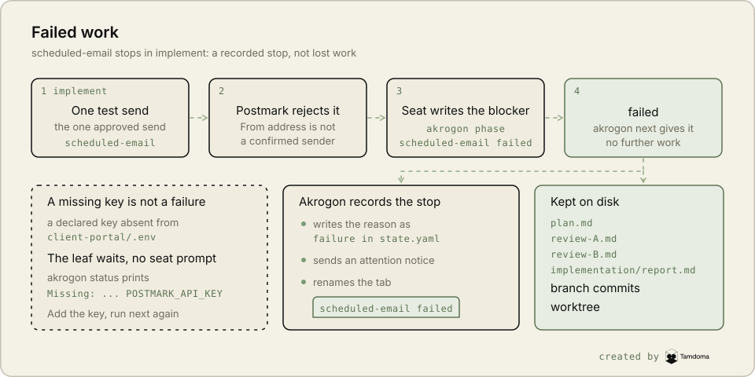
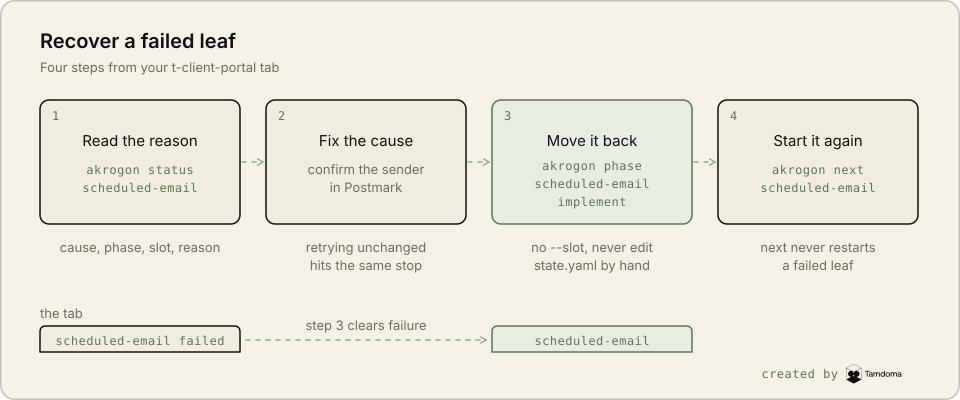
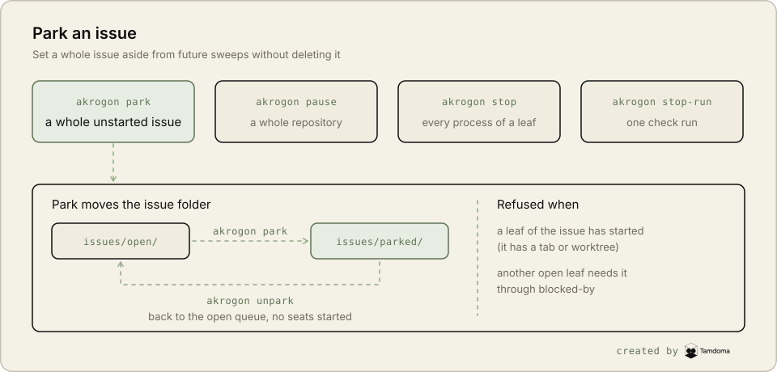
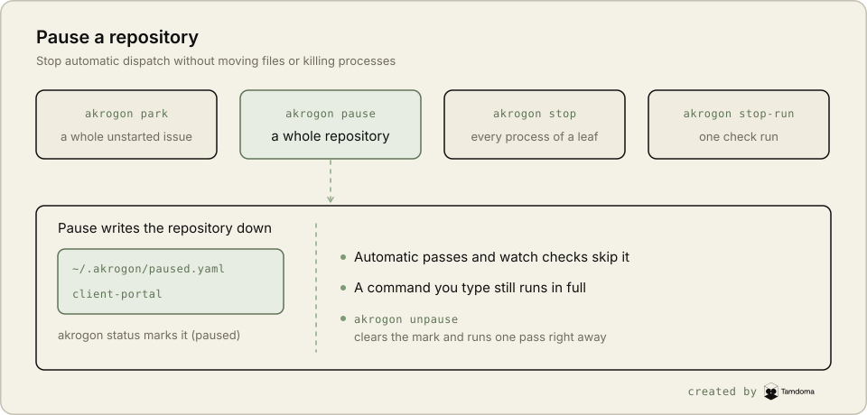
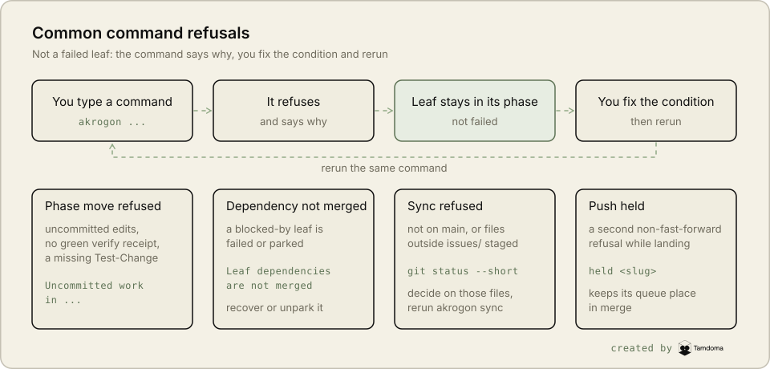
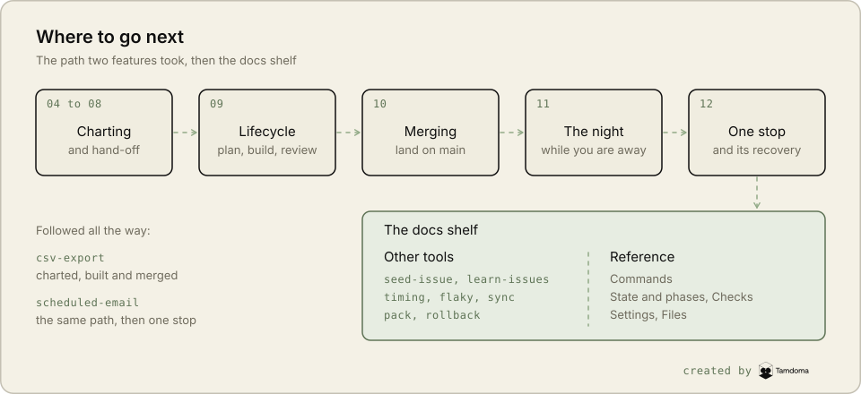

# When work stops

Work stops for one of two reasons: a seat hit a blocker and moved the leaf to `failed`, or you deliberately held work back with `park`, `pause`, `stop`, or `stop-run`. In every case, your plan, reviews, and committed code stay intact on disk.

This page walks through recovering a failure on `client-portal`'s `scheduled-email` (after `csv-export` has already merged), then covers each control for holding or stopping work and the most common command refusals.

## Failed work



**A failed leaf is a recorded stop, not lost work.** When a leaf moves to `failed`, Akrogon keeps its `plan.md`, `review-A.md`, `review-B.md`, `implementation/report.md`, branch commits, worktree, and the exact reason it stopped.

A seat stops a leaf whenever it hits something only a person can supply or decide. For example, `scheduled-email` reaches `implement` and runs its one approved test send to `staging-reports@agency.example`, but Postmark rejects it because the From address is not a confirmed sender in your Postmark account. Only you can confirm that sender. The seat writes the blocker and exact operator action into its pass artifact, runs:

```sh
akrogon phase scheduled-email failed --slot A --reason "<what blocks the work>"
```

and ends its pass without waiting in chat. (Akrogon itself can also move a leaf to `failed` if a seat ends 3 turns silently without reporting, is lost 3 times before ending a turn, or hits a non-refusal git push error during `akrogon land`.)

When a leaf moves to `failed`, Akrogon records the `failure` field in `state.yaml`, sends an attention desktop notice, and renames the leaf's herdr tab to `scheduled-email failed`. `akrogon next` gives it no further work until you recover it.

A key that is simply missing does not fail a leaf. When a key the chart declared (in the leaf's `readiness.yaml`) is absent from `client-portal/.env`, the leaf never gets a seat prompt: it waits, `akrogon status` prints a `Missing:` line such as `Missing: client-portal/scheduled-email env POSTMARK_API_KEY in client-portal: ...`, and a typed `akrogon next scheduled-email` refuses with `Leaf inputs are missing`. Add the key to `client-portal/.env` and run `akrogon next scheduled-email` again. No phase recovery is needed (see [Why a ready task may wait](09-lifecycle.md#why-a-ready-task-may-wait)).

### Recover a failed leaf in four steps



From your `t-client-portal` tab:

1. **Inspect the failure reason**:

   ```sh
   akrogon status
   akrogon status scheduled-email
   ```

   `akrogon status` prints a `Failed:` summary line naming the stopped leaf and its reason, and `akrogon status scheduled-email` prints the full `failure` block (`cause`, `phase`, `slot`, and `reason`). The reason names the blocker and points to the file holding the exact action, often `plan.md`, `implementation/report.md`, or `review-B.md`. Here it says to confirm `staging-reports@agency.example`'s sender in Postmark.

2. **Fix the underlying cause**:
   - For this example, confirm the sender in Postmark.
   - For broken code, an expired token, or a broken test on `main`, fix that cause first. Retrying unchanged reproduces the exact same stop.
   - If a key such as `POSTMARK_API_KEY` goes bad, replace it in `client-portal/.env`. **Never** add keys directly to `~/.akrogon/worktrees/client-portal/scheduled-email/.env`, because Akrogon writes worktree `.env` files from the registered checkout.

3. **Move the leaf back to an active phase with no `--slot`**:

   ```sh
   akrogon phase scheduled-email implement
   ```

   Only the operator can recover a failed leaf; any `akrogon phase` call carrying `--slot` on a failed leaf is refused. Pick the active phase that matches the remaining work (`plan.synthesis`, `implement`, `check.review`, `check.repair`, `check.fix`, or `merge`; never `merged`).

   **Never edit `state.yaml` by hand** to clear a failure. Akrogon writes `state.yaml` read-only so commands own those fields. Using `akrogon phase` clears `failure`, removes any pending failed notice, renames the tab back to `scheduled-email`, and **keeps `fix_rounds`**, so a review after an earlier repair round remains slot B only. Recovery straight into `check.review` or `merge` still runs the `Test-Change:` checks.

4. **Start the leaf again**:

   ```sh
   akrogon next scheduled-email
   ```

   `akrogon next` never restarts a leaf that is still in `failed`, so always run step 3 first. Skipping it either refuses with `Leaf is failed and needs phase recovery` or, when the leaf's seat terminals are already gone, does nothing and exits without an error.

## Park an issue



Parking moves a whole top-level issue (or epic) folder out of `issues/open/` into `issues/parked/` when you want to set it aside from future sweeps without deleting it. Run these commands inside `client-portal`:

```sh
akrogon park weekly-client-report   # park one or more issues by top-level folder name
akrogon park --all                  # park every eligible issue in the repository
```

`akrogon park` prints `parked   <issue>` for each moved folder. Parking is refused in two cases:

- **A leaf of the issue has already started** (it has a recorded tab or worktree). Stopping a leaf keeps its worktree and records, so parking is still refused; use `akrogon stop` or `akrogon pause` for work already in progress.
- **Another open leaf depends on it** via `blocked-by`, because parking it would leave that open leaf stranded.

With `akrogon park --all`, ineligible issues are skipped and listed as `running`, `needed`, or `unreadable`.

To bring parked issues back into `issues/open/`:

```sh
akrogon unpark weekly-client-report
akrogon unpark --all
```

Unparking returns the issue to the open queue without starting seats right away. Start it when ready with `akrogon next <slug>` (subject to `blocked-by` dependencies and `max_active`).

## Pause a repository



Pausing stops automatic dispatch for the current repository without moving files or killing running processes:

```sh
akrogon pause
```

This writes `client-portal` into `~/.akrogon/paused.yaml` and prints `client-portal paused`. While paused:

- Automatic passes (`akrogon next --wake` and `akrogon next --resume` from `akrogon-listener.service`) do nothing for `client-portal`, including leaves that already have a tab, and `watch-issues` checks see `paused=true` and stop without acting.
- A command you type yourself (such as `akrogon next csv-export`) **still runs in full**, and `client-portal` stays paused afterward.
- `akrogon status` marks the repository `(paused)`.

Turn automatic dispatch back on with:

```sh
akrogon unpause
```

`akrogon unpause` clears the pause mark, prints `client-portal unpaused`, and **runs one pass right away** (resuming leaves with a tab or worktree, refilling capacity waiters, running the merge pass, and running cleanup).

Pause and park serve different jobs: **park** removes whole unstarted issues from the open queue, while **pause** freezes automatic dispatch across the entire repository, running leaves included.

## Stop a leaf or a check run


### Stop and restart a leaf

To end every process a leaf's seats started (including browsers, worker scripts, live or waiting check runs, and any verify pass or land run):

```sh
akrogon stop scheduled-email   # stop one leaf
akrogon stop --all             # stop every in-progress open leaf in the repository
```

Akrogon records `client-portal/scheduled-email` in `~/.akrogon/stopped.yaml`, ends its seat terminals, stops the leaf's systemd slice and active runs, and prints `stopped: client-portal/scheduled-email`. The worktree and files stay intact (and any panes you split by hand in the tab sit outside the slice and survive). If a stop fails, the leaf remains marked stopped and the command exits non-zero so you can rerun it; under `--all`, one failure does not stop the rest from being processed.

While a leaf is stopped:

- Automatic passes skip it quietly.
- A typed `akrogon next scheduled-email` exits 1 with `Leaf is stopped: scheduled-email; run akrogon start scheduled-email`.
- `akrogon status` shows `stopped` in the leaf's row, and `akrogon status scheduled-email` prints `stopped: client-portal/scheduled-email`.

Resume a stopped leaf with:

```sh
akrogon start scheduled-email
```

`akrogon start` clears the stopped mark and immediately runs `akrogon next` for that leaf (exiting with an error if the leaf is not stopped).

### Stop one check run or verify pass

Every `akrogon run-check` and `akrogon verify` prints `run <run-id>` when it starts. Stop one long check run or verify pass (or cancel a waiting `full` check in the queue) without touching the rest of the leaf:

```sh
akrogon stop-run <run-id>
akrogon stop-run               # stops your only live run, or lists them if more than one
```

`akrogon stop-run` only stops runs started from your own pane scope, so other seats and leaves cannot be disturbed. Never use pattern kills (`pkill -f`, `killall`, or `pgrep | xargs kill`), which match processes across leaves.

### Clean up leftovers

Akrogon's automatic reconciliation removes worktrees, temp folders, and systemd slices of finished leaves on its own. When cleanup keeps a path or unit that needs a person to inspect it, list everything kept with:

```sh
akrogon leftovers
```

Output is grouped by repository and reason, plus a `host` group for systemd units and retired host paths, or prints `no leftovers` when nothing needs attention. Run outside a repository, it covers every registered repository. Active worktrees, live tabs, and runs in progress are omitted because they clear on their own when work finishes.

## Common command refusals



These are **not** failed leaves. A command refuses and tells you why; fix the condition and rerun it:

- **Phase-move refusal**: Common causes are uncommitted edits in the leaf worktree (`Uncommitted work in ...`), files under `issues/` modified on the leaf branch, an empty branch when entering `check.review`, a missing green `akrogon verify` receipt for the latest commit (`HEAD`), a changed or added test file missing a `Test-Change: <path> <source and reason>` trailer, leftover `<slug>-u<N>` worker worktrees, or an abandoned `capture-<name>-<run>-out.log`/`-err.log` pair without a non-blank `cleared-<run>.md` beside it. See [Checks](../reference/checks.md#refusals-and-what-to-do).
- **Failed or unavailable dependency**: If `scheduled-email` lists `csv-export` in `blocked-by` and `csv-export` is `failed`, `parked`, `missing`, or `unreadable`, `akrogon next scheduled-email` refuses with `Leaf dependencies are not merged` until `csv-export` is recovered or unparked and merged.
- **Sync refusal**: `akrogon sync` runs only inside the registered checkout on its `default_branch` (`main`), and refuses if `HEAD` is detached or on another branch, if files outside eligible `issues/` records are staged, or if incoming commits collide with ignored local paths or active lock files. Check with `git status --short` and `git diff --cached --name-only`, decide what to do with those files, and rerun `akrogon sync`.
- **Non-fast-forward push refusal**: During landing, a first non-fast-forward refusal restacks onto the new remote tip and retries once automatically. A second refusal clears the batch, prints `held <slug> attempt=<id>`, and keeps the leaf's queue place in `merge` for the next pass. Any other push error moves the leaf to `failed` with Git's error output (`stderr`) in `failure.reason`. See [Merging](10-merging.md).

## Where to go next



You have followed a feature all the way from charting through lifecycle execution, merging, overnight watching, and failure recovery. For standalone tools (`seed-issue`, `learn-issues`, `timing`, `flaky`, `sync`, `pack`, and `rollback`) and complete lookup tables, head to the docs shelf:

- [Other tools](../README.md#other-tools)
- [Reference](../README.md#reference) and [Commands](../reference/commands.md)
- [State and phases](../reference/state-and-phases.md), [Checks](../reference/checks.md), [Settings](../reference/config.md), and [Files](../reference/files.md)

Previous: [While you are away](11-while-you-are-away.md) · Next: [Docs home](../README.md)
