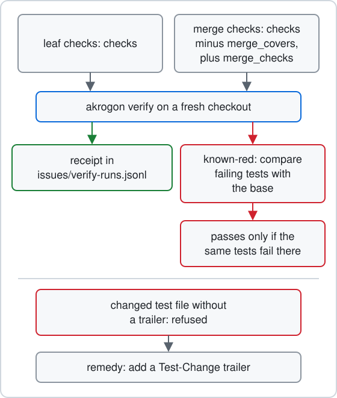

# Checks

This page explains how akrogon runs your checks, what proof a phase move asks for, and what to do when a move is refused. Each command named here has a one-line entry in [Commands](commands.md#checks-and-logs). The check settings live in [Settings](config.md#repo-issuesconfigyaml).



## What runs where

You set four kinds of command in `issues/config.yaml`:

| Setting | When it runs | Does a failure block? |
| --- | --- | --- |
| `checks` | On every leaf, and again at merge. | Yes. |
| `merge_checks` | Only at merge, through the merge turn's `akrogon verify --attempt <id>`, its members all at once after the `checks` stage is green. `akrogon run-check` refuses them. | Yes. |
| `merge_covers` | Not a command. It names `checks` entries that a merge check already covers, so merge skips them. | No. |
| `advisory` | Seats run them next to the checks. `akrogon verify` does not run them. | No. Reviewers report a failure as a Nit. |

So a leaf runs every `checks` command. A merge runs every `checks` command not named in `merge_covers`, then, once they are green, the `merge_checks` members all at once. Each stage runs only what lacks a green result for that command on the same tree, marking the receipt entry `reused` and naming the source run; a red `checks` entry leaves every member recorded not run. Source: `verifyCommands` in [src/verify.ts](../../src/verify.ts).

`setup` runs first. It is the install command for a fresh checkout, such as `bun install --frozen-lockfile`. Before any check command, akrogon runs `setup` and then `akrogon guard own-modules`. When `setup` fails, every check in that run is recorded with the setup result, and the run cannot count as a receipt. `akrogon config` prints each check already wrapped this way, with the wrap in `withSetup` in [src/config.ts](../../src/config.ts).

## Keep output with akrogon run-check

A seat keeps command output only by running the command through `akrogon run-check`:

```sh
akrogon run-check --name <label> -- <command> <args>
```

When the command ends, run-check prints one line to stderr and exits with the command's exit code:

```text
check <label>: <exit> <path>
```

`<path>` is the saved log. It lands in the leaf's `implementation/` folder as `check-<label>-<time>-<pid>.log`. Akrogon finds the leaf from your current worktree. A worker worktree named `<slug>-u<N>` saves into its leaf's folder. Outside a leaf worktree, pass `--leaf <path>` or `--holder <dir>`, and the log goes there.

The command runs with a clean environment. It gets `HOME`, `PATH` and a few other basics, the names you list in `env` and `pass_env`, a private `TMPDIR` and `AKROGON_BASE`. Source: [src/run-check.ts](../../src/run-check.ts).

run-check refuses a configured `merge_checks` command, given as its words, as `sh -c '<command>'`, or in the `sh -c` form `setup` would add: it exits non-zero, starts no process and saves no log, printing `akrogon verify --attempt <id>` as the merge suite's only runner and that a red merge check is reproduced with a narrower command, never the whole suite.

When to keep output this way, and which commands are exempt, is a seat rule. See [implement-issue](../../skills/implement-issue/SKILL.md), [check-issue](../../skills/check-issue/SKILL.md) and [merge-issue](../../skills/merge-issue/SKILL.md).

## Prove a commit with akrogon verify

`akrogon verify` checks one commit, `HEAD` unless you pass `--sha <rev>`. It:

1. Checks the commit out fresh in the worktree store, in a folder named `verify-<id>`.
2. Runs `setup`, then every check for the scope that lacks a green result under the same name and command text on the same tree (`merge_checks` members at the same time), and logs each one.
3. Writes one receipt line to `issues/verify-runs.jsonl` with each command, its exit code and its log path; an entry copied from an earlier run carries `reused` naming the source run.
4. Removes the fresh checkout.

The scope is `leaf` while the leaf is in any phase other than `merge`. It is `merge` for a merge leaf (`--attempt <id>`) or a `--holder` run. While it runs, it prints `verify setup: <exit> <log>`, then `verify <name>: <exit> <log>` for each check, then `verify <scope> <sha>: green` or `red`.

A receipt is reused. When a green receipt already exists for the same tree and the same list of command names and commands, verify prints `reuse receipt <run> tree=<tree>` and exits 0 without running anything. Reuse is also per command: a green entry in a completed run on the same tree is copied into the new receipt with `reused`, so a changed command reruns while its siblings reuse. Changing a check command in config makes old receipts stop counting.

These phase moves need a green receipt for the current commit:

| Move | Scope |
| --- | --- |
| Any move into `check.review` | `leaf` |
| `check.repair` to `merge` | `leaf` |
| `merged`, including `akrogon land` and `merged --check` | `merge` |

The gate counts a command green when a completed run holds it green on the same tree under the same name and command text, so entries may come from different runs. Without cover, the move fails with `No green <scope> verify receipt for <sha> under the current config; run akrogon verify on this commit`. Source: `requireGreenReceipt` in [src/verify.ts](../../src/verify.ts) and its callers in [src/phase.ts](../../src/phase.ts).

## Known red

Sometimes a test is already red on the default branch. `akrogon verify --known-red` shows that the red is not caused by your change:

1. It takes the newest finished red run of this tree and command set from the receipts, or runs the commit now. If that run is green, it stops with exit 0.
2. It runs the merge-base of the commit and the tracked default branch, reusing each command already green on the base tree under the same name and command text and running only what lacks one, and links that run to the red head run.
3. It prints `verify known-red <sha>: pass` or `fail`.

A cover is found per red command: a completed run on the head tree holds the command red with named failed tests, and a completed run linked from that head run holds the same command red on the base tree with every one of those names. A base entry with exit 0 never covers a red head command, whatever its log says and whether it ran fresh or was reused, and commands green on the head need no cover. Akrogon reads failed test names from `(fail) <name>` lines in the logs. A red command whose log names no failed test is uncovered.

A pass counts as a receipt for the phase moves above.

When a seat should retry a red command, and when it should run known-red, is a seat rule. See the retry and known-red rules in [implement-issue](../../skills/implement-issue/SKILL.md), [check-issue](../../skills/check-issue/SKILL.md) and [merge-issue](../../skills/merge-issue/SKILL.md). Who may replace a wrong proof command is in [plan-issue](../../skills/plan-issue/SKILL.md) and [implement-issue](../../skills/implement-issue/SKILL.md).

## Test-change refusals

Phase moves protect tests. A file counts as a test file by the path rule in [src/test-files.ts](../../src/test-files.ts): a folder in its path named `test`, `tests`, `__tests__`, `fixture`, `fixtures`, `__fixtures__`, `__snapshots__`, `e2e`, `spec`, `specs`, `testdata`, `golden` or `goldens`, a name ending in `.snap`, or a name like `*.test.*`, `*.spec.*`, `*.e2e.*` or `*_test.*`.

Two checks run on each phase move from a leaf worktree, and again on the merge attempt. A recovery from `failed` back into work skips them, because the seat's next move runs them on the same diff. A recovery straight into `check.review` or `merge` still runs them.

1. Old test files. A test file that existed on the base and was changed or deleted on the branch is refused.
2. Drift from the plan. At the `plan.synthesis` to `implement` move, akrogon records every path changed on the branch and its content. Later, a recorded path that changed or vanished is refused, and so is a new test file that is not in the record.

A refused path passes when a commit carries this trailer in its final trailer block:

```text
Test-Change: <path> <source and reason>
```

For an old test file, any commit on the branch may carry it. For drift, the trailer must sit in the last commit that touches the path or a later one. When no branch commit touches the path, a commit with no file changes made after the record must carry it. Such a commit works in every case:

```sh
git commit --allow-empty -m "<message>" -m "Test-Change: <path> <source and reason>"
```

The refusal starts with `Changed test files need a citation:` and lists one ready `Test-Change:` line per missing path. Source: `requireTestChangeCitations` and `requireFrozenCitations` in [src/phase.ts](../../src/phase.ts).

Whether a test may change at all is a seat rule, not a trailer question. See [check-issue](../../skills/check-issue/SKILL.md) and [merge-issue](../../skills/merge-issue/SKILL.md).

## akrogon guard

`akrogon guard` protects checks from picking up packages that are not the checkout's own:

- `akrogon guard ancestors` fails when a folder above the checkout holds `node_modules` or `package.json`.
- `akrogon guard own-modules` fails when the checkout has `package.json` but no `node_modules` of its own.

`akrogon verify` applies the same folder-above rule to its fresh checkout before it starts. Source: [src/guard.ts](../../src/guard.ts).

To fix `ancestors`, move the checkout, or set `worktree_root` in [Settings](config.md#repo-issuesconfigyaml) to a folder with no `node_modules` or `package.json` above it. To fix `own-modules`, set `setup` to your install command.

## Read a log

Every `check` line and every verify line ends in a log path. Print that log with:

```sh
akrogon log <path>
```

It works from any directory. It also works after a closed issue's logs were packed into `evidence.tar.zst` by `akrogon pack`, because it reads the log out of the archive. Source: `readLog` in [src/evidence.ts](../../src/evidence.ts).

`akrogon flaky` lists checks and tests that went red and then green on the same tree, newest first, from the receipts. Each line shows the count, the last time, the check name and the test name. Source: [src/flaky.ts](../../src/flaky.ts).

## Refusals and what to do

| You see | What it means | What to do |
| --- | --- | --- |
| `No green <scope> verify receipt for <sha> under the current config; run akrogon verify on this commit` | The move needs a receipt for this exact commit and command set. | Run `akrogon verify` in the leaf worktree, or `akrogon verify --attempt <id>` at merge. If it is red only from tests already red on the base, run `akrogon verify --known-red`. |
| `verify known-red <sha>: fail` | A head failure is not on the base, or a red log names no failed test. | Treat it as your failure and fix it. |
| `Changed test files need a citation:` | A test file changed with no `Test-Change` trailer. | Add the listed trailer lines to a commit, or an empty commit, on the branch. |
| `ancestor <dir> holds node_modules or package.json` | A folder above the checkout could leak packages into checks. | Move the checkout or `worktree_root` away from that folder. |
| `Refusing location: canonical ancestor <dir> holds node_modules or package.json` | Same problem, found by `akrogon verify` for its fresh checkout. | Set `worktree_root` to a folder with nothing like that above it. |
| `missing own node_modules: <path>; set setup in issues/config.yaml to install dependencies in each fresh checkout` | The checkout has no installed packages. | Set `setup` to your install command. |
| `Refusing to run: <NAME> is set` | One of `NODE_PATH`, `BUN_OPTIONS`, `BUN_INSTALL_CACHE_DIR`, `FFMPEG_BIN`, `CHROME_PATH` or `CDP_BROWSER_BINARY` is set in your shell. | Unset it and run again. |
| `Refusing to run: global bunfig at <file>` | A `.bunfig.toml` in your home or `XDG_CONFIG_HOME` would change test runs. | Move or delete that file. |
| `No leaf worktree matches cwd; pass --leaf or --holder` | run-check or verify cannot tell which leaf the log belongs to. | Run from the leaf worktree, or pass `--leaf <path>` or `--holder <dir>`. |
| `Use --leaf or --holder, not both` and `Use --attempt or --holder, not both` | Two ways to name the owner were given. | Pass only one. |
| `No merge leaf for attempt: <id>` | No leaf in `merge` holds that attempt. | Check the attempt id in the batch record of the leaf's `state.yaml`. |
| `owner closed: <path>` or `owner closing: <path>` | The leaf that would own the log is closed or being closed. | Do not keep new output for it. |
| `owner gone: <path>; captured output stays in <log>` | The leaf closed while the command ran. | Read the output at the named log path. |
| `no log for recorded path: <path>` | The path does not point into an issue folder, or the log and its archive are gone. | Copy the path exactly from the `check` or verify line. |
| `recorded path <path> matches repos: <names>` | Run outside a repository, the path fits more than one registered repository. | Run `akrogon log` from inside the right repository. |
| `unreadable archive: <path>` or `no member <name> in <path>` | The packed archive is damaged or lacks that log. | The log cannot be read back. Rerun the check if you need the output. |
