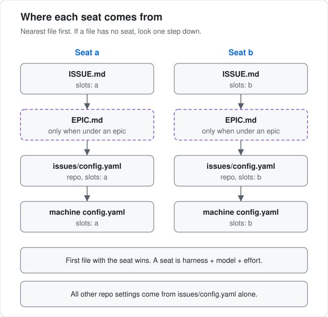

# Settings

Akrogon reads its settings from three places. This page says what each place holds and which one wins when two of them set the same seat. The rules live in [src/config.ts](../../src/config.ts).



To see the settings that apply where you stand, run:

```sh
akrogon config
```

It prints the machine settings, the repo settings and the two seats after the lookup below. Run it inside a leaf worktree to see that leaf's seats.

## The three places

1. Machine `config.yaml`. One per machine.
2. Repo `issues/config.yaml`. One per registered checkout.
3. `slots:` front matter at the top of an issue's `ISSUE.md` or an epic's `EPIC.md`. Optional.

## Machine config.yaml

Akrogon looks for `config.yaml` in its home folder. The home folder is `$AKROGON_HOME` when that variable is set, otherwise `~/.akrogon`. If that folder has no `config.yaml` but the akrogon checkout itself has one, akrogon uses the checkout's file instead.

| Key | What it does |
| --- | --- |
| `max_active` | How many leaves may run at once across all registered repos. When that many are running, akrogon starts no new leaf. Work already running is not stopped. A positive whole number. Default 3. |
| `slots` | The default seats `a` and `b`. Both are required. Each seat is a `harness`, a `model` and an `effort`. |
| `harnesses` | Maps a harness name to the command that starts it. `{model}` and `{effort}` in the command are filled from the seat. The command must start with the harness name. Every seat's harness must have an entry here. |
| `toolkits` | Test toolkit choices per language, for example `<language>: <runner>`. Setup reads them when a repo has no tests. Default empty. |
| `repos` | Maps a repo name to its checkout folder. A relative path is read from the akrogon home folder, and `~` means your home folder. Default empty. |

```yaml
max_active: 3
slots:
  a: { harness: claude, model: <model>, effort: <effort> }
  b: { harness: codex, model: <model>, effort: <effort> }
harnesses:
  claude: claude --model {model} <other flags>
  codex: codex --model {model} <other flags>
toolkits:
  <language>: <runner>
repos:
  <repo-name>: <path-to-checkout>
```

## Repo issues/config.yaml

Each registered checkout has `issues/config.yaml`. The [init-akrogon skill](../../skills/init-akrogon/SKILL.md) proposes and writes it. Only `grounding` is required.

| Key | What it does |
| --- | --- |
| `remote` | The git remote to push to. Default `origin`. |
| `default_branch` | The branch leaves start from and land on. Default `main`. |
| `worktree_root` | Where leaf worktrees go. It must be outside the checkout. Default `~/.akrogon/worktrees/<repo-name>`. |
| `rebuttal` | Whether planning has a rebuttal round after the two positions. Default `true`. |
| `fix_rounds` | How many repair rounds the chart door's direct route may use. Default 3. |
| `implement` | `subagents` lets seat A hand units to worker agents. `inline` makes seat A do all the work itself. Default `subagents`. |
| `setup` | A command that installs dependencies in each fresh checkout, such as `bun install --frozen-lockfile`. Akrogon runs it before check commands. Optional. |
| `checks` | Named commands every leaf must pass. A red check blocks. Default empty. |
| `merge_checks` | Named commands that run only at merge. `akrogon config` prints `akrogon verify --attempt <id>` for each entry — the merge turn's runner — and `akrogon run-check` refuses the command itself. Default empty. |
| `merge_covers` | Names from `checks` that a merge check already covers, so merge skips them. Needs a non-empty `merge_checks`. Default empty. |
| `advisory` | Commands that run but never block. Their failures are reported as small notes. Default empty. |
| `env` | Names of environment variables. Each must be set in the checkout's `.env`, and akrogon writes them into each leaf worktree's `.env`. Check commands also get them from your shell. Default empty. |
| `pass_env` | Names of environment variables check commands get from your shell, with no `.env` copy. Default empty. |
| `tools` | Command-line tools whose path and version akrogon records at the start of each merge. A missing tool stops the merge. Default empty. |
| `grounding` | Where agents find the repo's docs. `index` names the top index file, which must exist and not be empty. `docs`, `surfaces` and `indexed_scopes` are optional lists. Write `none` to have no grounding. |
| `broadcast` | Optional. `discord.webhook_env` lists the environment variable names that hold Discord webhook URLs for completion updates. |
| `slots` | Optional seat overrides for this repo, `a`, `b` or both. |

Checks run on every leaf, while merge checks run only when a leaf lands.

Environment variable names in `env` and `pass_env` use capital letters, digits and `_`. A few names akrogon sets itself, such as `TMPDIR` and `AKROGON_BASE`, are refused.

```yaml
remote: origin
default_branch: main
rebuttal: true
fix_rounds: 3
implement: subagents
setup: <install-command>
checks:
  <check-name>: <command>
merge_checks:
  <merge-check-name>: <command>
merge_covers: [<check-name>]
advisory: []
env: [<VAR_NAME>]
pass_env: []
tools: []
grounding:
  index: <path-to-index.md>
broadcast:
  discord:
    webhook_env: [<WEBHOOK_VAR_NAME>]
slots:
  b: { harness: codex, model: <model>, effort: <effort> }
```

## slots front matter in ISSUE.md or EPIC.md

An issue or epic can set its own seats. The block must be the very first thing in the file: line one is `---`, and a later `---` closes it. The block may hold only `slots:`, with `a`, `b` or both. A file with no block is skipped. A broken block stops akrogon with an error that names the file.

```markdown
---
slots:
  a: { harness: claude, model: <model>, effort: <effort> }
---
# <issue title>
```

## Which seat wins

Akrogon looks up seat `a` and seat `b` separately. For each seat it checks these files in order and takes the first one that sets that seat:

1. The issue's `ISSUE.md`.
2. The epic's `EPIC.md`, only when the issue sits inside an epic.
3. The repo's `issues/config.yaml`.
4. The machine `config.yaml`.

Akrogon finds the files from the leaf's folder under `issues/open` or `issues/closed`. A leaf at `<issue>/<leaf>` uses `<issue>/ISSUE.md`. A leaf at `<epic>/<issue>/<leaf>` uses `<epic>/<issue>/ISSUE.md`, then `<epic>/EPIC.md`. Outside a leaf, only the repo and machine files count.

A seat is always taken whole. If `ISSUE.md` sets seat `a`, its `harness`, `model` and `effort` all come from `ISSUE.md`. No field is mixed in from a lower file. Seat `b` can still come from a different file.

The winning seat's harness must be listed in the machine `harnesses`. If it is not, akrogon stops with an error.

Seats are the only setting these files share. Every other repo setting comes from `issues/config.yaml` alone.
