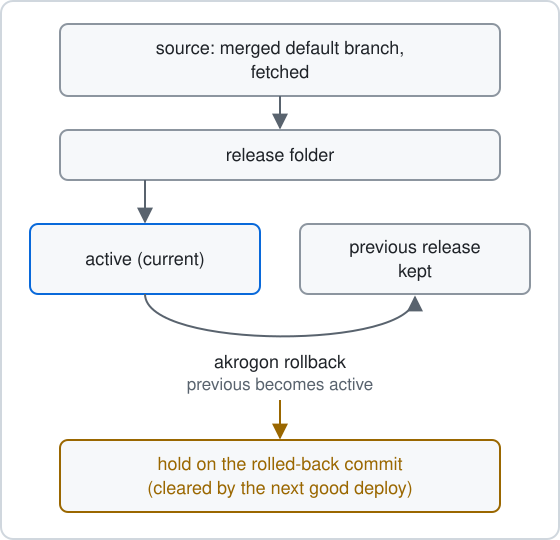

# Releases and updates

Akrogon runs from an installed release, not from your source checkout. Landed work reaches the release through a deploy. This page explains where releases live, how registered checkouts follow the default branch, what starts a deploy and how a failed update shows up.

## Release and checkout

The state home is `~/.akrogon`, or the folder in `AKROGON_HOME`. It holds three release paths:

- `releases/<commit>` is one built release per deployed commit. A release is the tracked tree from `git archive` plus `bun install --frozen-lockfile`. It is not a Git checkout.
- `current` is a link to the active release. The `akrogon` command, the skills, the systemd slice and the Herdr plugin all link through `current`. `~/.local/bin/akrogon` points at `current/src/akrogon.ts`.
- `deploy.yaml` records the active commit, the previous commit and the result of the last deploy.

The previous release is the one that was active before the last deploy. It is kept so `akrogon rollback` has a target. Other releases are removed about a day after they stop being active or previous.

On a fresh install, `current` points at the source checkout itself. The first successful deploy switches it to a release and prints `switched from checkout to release`. From then on, editing files in the checkout does not change what the `akrogon` command runs.

Sources: [src/release.ts](../../src/release.ts) (`releasesDir`, `currentLink`, `ensureCurrent`, `buildRelease`, `pruneReleases`), [src/install.ts](../../src/install.ts) (`planSkillLinks`), [src/config.ts](../../src/config.ts) (`globalHome`).

## How checkouts follow main

The self-update step runs for each registered checkout a run covers. For each one it does this:

1. It skips the checkout when it is not on the default branch and prints `self-update skipped` with how far behind it is.
2. It fetches the default branch. If the checkout already matches it, nothing changes.
3. Local commits are replayed onto the fetched tip and pushed only when every one of them touches only issue records under `issues/`. Any other local commit stops the step with `ahead of` or `diverged from` and tells you to run `akrogon sync`.
4. It moves the checkout to the new tip and keeps your uncommitted edits. If an edit overlaps an incoming change, the move waits and prints `checkout pending`. Commit or finish the edit, and the next trigger retries.

It prints one line per checkout, such as `pushed 1 record commit(s)`, `deployed <old>..<new>` or `current <commit>`.

Sources: [src/self-update.ts](../../src/self-update.ts) (`selfUpdate`, `gitStage`, `moveCheckout`), [src/sync.ts](../../src/sync.ts) (`integrate`, `eligibleRecord`).

## What starts a deploy

Self-update runs on these triggers:

- A leaf moves to `merged`, through `akrogon phase` or a landing run.
- `akrogon next` with a target, or run by hand from a leaf or worktree folder.
- `akrogon next --all` and `akrogon next --resume`, which cover every registered checkout.

For the Akrogon repository only, self-update then deploys the tip of the remote default branch. It does nothing when that commit is already active and recorded as a success. Otherwise it builds the release, updates the links, flips `current` to the new release, reloads systemd user units and relinks the Herdr plugin, then writes `deploy.yaml`. The deploy reads the remote tip, not your checkout, so an uncommitted edit never goes live and never blocks a deploy.

A commit held by `akrogon rollback` is not deployed. The step prints `deploy held` instead. The hold ends once a different commit deploys.

Sources: [src/next.ts](../../src/next.ts) (`nextCommand`, `mergeWake`, `landedWake`), [src/akrogon.ts](../../src/akrogon.ts) (`phase` case), [src/self-update.ts](../../src/self-update.ts) (`deployStage`), [src/release.ts](../../src/release.ts) (`flip`, `writeDeploySuccess`).

## When an update fails

A failed deploy prints `deploy failed: <step>: <error>; retried at the next trigger`. The step is one of `fetch`, `resolve`, `hold`, `archive`, `install`, `links`, `flip`, `reload` or `record`. The same failure is written to `deploy.yaml` with `ok: false`, the attempted commit, the step and the error.

A failure at or before `flip` leaves `current` on the active release. Link conflicts are rejected before any link changes. A failure in `reload` or `record` happens after `current` already points at the new release.

`akrogon status` keeps showing `deploy failed: attempted <commit>, active <commit>, step <step>: <error>` until a later deploy succeeds.

A failed fetch or push in the checkout step prints `fetch failed` or `push failed` and is retried at the next trigger. Any other error prints `self-update failed: <error>`. Neither stops the rest of the run.

Sources: [src/self-update.ts](../../src/self-update.ts) (`deployStage`, `selfUpdate`), [src/release.ts](../../src/release.ts) (`writeDeployFailure`), [src/status.ts](../../src/status.ts).

## Rollback

`akrogon rollback` makes the previous release active and holds the rolled-back commit so it does not redeploy. See [src/rollback.ts](../../src/rollback.ts).
