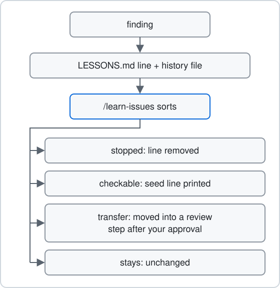

# Learn from work

Some findings matter beyond the leaf that found them. A seat writes such a finding as a lesson, so later charting and planning can check it. You clear lessons that no longer apply with `/learn-issues`.



## What a lesson is

A lesson has two parts:

- One active line in `learnings/LESSONS.md`. It names the mechanism, the date and the history file.
- A history file at `learnings/history/<date>-<slug>.md`. It holds the case, the evidence and the learning.

The planning, building, review and charting skills write lessons. Charting and planning read the list. Review and build passes do not take it as input. A lesson is an observation to check, not a permanent rule.

Every write follows the [lesson rule](../../skills/lesson-rule.md):

- A lesson with the same failure cause and scope as an active line adds its case to that line's history file instead of a new line.
- A lesson a command could detect as a fixed pattern gets a `/seed-issue` report, and the report URL goes in its history file.
- A lesson about akrogon's own skills or command is written into akrogon's `learnings/`.

## How a line leaves

A line leaves when its mechanism is stopped on every path where it can happen again. Three things count as a stop: the mechanism is removed, a reader or writer refuses it loudly before the harm, or a running check or guard covers it.

The leaf that delivers the stop removes the line and appends an `Applied <date> by <file:line or commit>: <what stops it>` line to the history file, in its own diff. If the line comes back during a rebase, the merge removes it again, and the push is refused while it is still present. See [lessons.ts](../../src/lessons.ts) and [merge-issue](../../skills/merge-issue/SKILL.md).

A closed, duplicate or rejected report never removes a line.

## Clear the backlog

Run this when the list has grown and you want to clear what no longer applies:

```text
/learn-issues
```

Only you start it. No phase, chart or command runs it for you. It works on `learnings/LESSONS.md` in the registered checkout, never in a worktree. It reads each line's history file, traces the mechanism through current code and checks, and sorts the line into one outcome:

- **Stopped.** The mechanism is stopped everywhere it can recur. The line is deleted and `Applied` is appended to its history file.
- **Checkable.** A command could detect the mechanism as a fixed pattern, and it is still reachable. You get one printed `/seed-issue` line. Nothing is filed.
- **Transfer.** A judgment lesson that one live review step in this repo reaches. The lesson is added to that step, the line is deleted and `Transferred` is appended to its history file.
- **Stays.** Everything else, such as judgment calls with no fitting step or missing evidence.

It prints the lines grouped by outcome with file:line evidence, then a footer with the counts. All edits stay uncommitted. Then you:

1. Review the diff, for example with `git --no-pager diff`.
2. Approve or decline each transfer. A declined transfer is reverted and its line stays.
3. Run any printed `/seed-issue` line you want filed.
4. Commit the result yourself.

See the [learn-issues skill](../../skills/learn-issues/SKILL.md) for the full procedure and [Skills](../reference/skills.md) for the other skills.

Next: [Save records](save-records.md)
