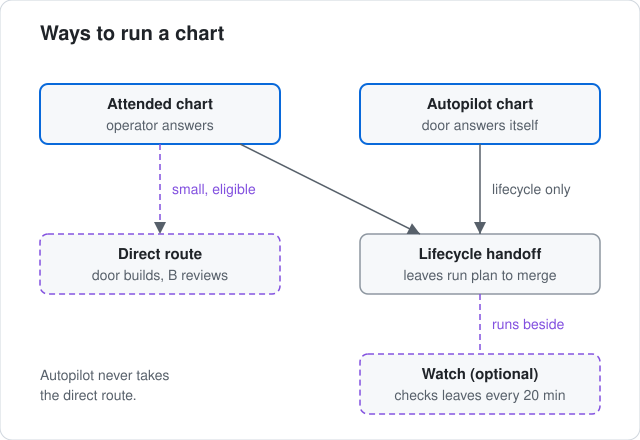

# Plan work

Charting turns a rough request into leaf contracts that agents can run without asking you questions. Use it when the work still has open choices, such as which rows a CSV export includes.

The [chart-issues](../../skills/chart-issues/SKILL.md) skill holds the full procedure. This page says what you run, what you see and why.

## Pick a way to run it



- Attended chart: you answer each question. This page covers it.
- Direct route: for a small, settled, code-only job. See [Quick fix](quick-fix.md).
- Autopilot: the door answers its own questions for a fixed list of work. See [Autopilot](autopilot.md).
- Write the files yourself: when nothing is left to decide. See [Write issues by hand](write-issues-by-hand.md).

## Open a chart

Open an agent in your registered repository and run:

```text
/chart-issues Add CSV export to widgets
```

The pane you run it in is the chart door, called A. Its first reply names the chart consultants you gave it, or says A works alone.

Chart consultants are helper panes (B, C, D and so on) that give A independent views while it charts. They are not the seats A and B that later work on a leaf. To add consultants, name their panes in your request. Inside Herdr you can ask for consultants without naming panes, and the door creates them.

Charts live in `issues/chart/<slug>/`. `CHART.md` lists what is settled, the open forks in the order they will be taken, the fog and what is off route. `INTAKE.md` keeps your original words apart from the agent's findings. Each fork has its own file under `forks/`. `akrogon status --charts` lists your charts.

## Read the territory map

Before asking anything, the door shows a map of the ground: the code it touches, the open choices, the risks and pitfalls. It inspects the live code, so the map can remove work you thought you needed or show that the job is really two jobs.

## Answer one fork per round



A fork is a question sharp enough to answer, for example "all rows or only the filtered rows?". Each round brings one fork with its options, a recommendation and its reason, and the research behind it. Pick an option or answer in your own words. Your answer and reason go into the fork file.

With consultants, each one researches the same question blind, without seeing A's or another consultant's notes. A merges the notes with tags that show who agreed, like `(A,B)`. Each consultant then names only where it disagrees, and you see that before you answer.

Fog is ground whose question is not clear yet, such as "exports are slow on large accounts". It needs investigation first. When a question in the fog becomes sharp, it moves into its own fork. Work you rule out goes under Off route with its reason.

## Review the handoff

Handoff waits until no fork or fog would leave an implementer guessing. Then the door shows one handoff review: the leaf tree, scope, the destination repository, your choices and each leaf's seats. It also asks whether the leaf runs with debate. The default is no.

When you approve, the door writes each leaf's `brief.md`, `design.md` and `state.yaml` under `issues/open/` and marks the chart `Handed off`. With consultants, each one reviews the draft contracts as an implementer before they are written. Read each brief and check that it says clearly when the job is done.

Handoff starts nothing. The leaves run when you run:

```sh
akrogon next <slug>
```

See [Run work](run-work.md). Optional: to keep leaves moving while you are away, see [Watch while away](watch-while-away.md).

For a small eligible chart with consultant B named, the review can offer the direct route instead. It skips the leaf handoff and `akrogon next`. It keeps the charted decisions and B's review of the code. See [Quick fix](quick-fix.md).

The full command list is in [commands.md](../reference/commands.md).

Next: [Quick fix](quick-fix.md)
