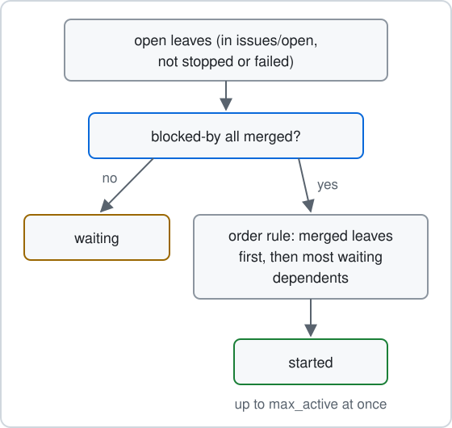

# Run work

`akrogon next` starts leaves that are ready and moves running ones forward. Use it after a leaf is handed off, or any time you want work to move.

Each run is one pass. It checks every picked leaf, prompts the seats (A and B) that the leaf's phase needs, and exits. It does not stay running.

## Pick what to run

Run these from inside your repository. The command takes one of four forms. You cannot combine them.

Run one leaf by its folder path:

```sh
akrogon next issues/open/<issue>/<slug>
```

Run every leaf of an issue or epic, or one leaf, by name:

```sh
akrogon next <issue>
akrogon next <slug>
```

A name must match one thing. If it matches more than one, for example an issue and a leaf with the same name, nothing starts. Akrogon lists each match by kind and path. Use the folder path instead. A target that exists as a folder from where you stand is always read as a path.

Run every leaf in the current repository:

```sh
akrogon next
```

Run every leaf everywhere:

```sh
akrogon next --all
```

Inside a repository, `--all` covers that repository. Outside one, it covers every registered repository. Plain `akrogon next` outside a registered repository fails.

`akrogon next --resume` is the startup form. It only resumes leaves that already have a tab or worktree, and skips paused repositories. You do not need to type it.

The full command list is in [commands.md](../reference/commands.md).

## How order is decided



A leaf starts only when every leaf in its `blocked-by` list is merged. Stopped and failed leaves are skipped.

A pass visits merged leaves first. Then it visits leaves that more unmerged leaves wait on, directly or through a chain, before leaves with fewer. There is no priority field.

`max_active` in your machine config limits how many leaves run at once across all registered repositories. At the limit no new leaf starts, but leaves that already have a tab keep working. Each leaf has two seats, so this is not a count of agent processes. See [config.md](../reference/config.md).

Leaves in the `merge` phase take turns. Each repository has one merge turn. Only the leaf holding it is prompted. The rest wait until it frees.

## When picked work cannot start

When you type `akrogon next`, every picked leaf that cannot start gets one line saying why. Ready leaves still start.

A leaf waiting on dependencies that are still in progress is normal. It prints this on stdout and does not fail the command:

```text
waiting: <slug> on <dependency> (<phase>)
```

These are errors on stderr, and the command exits 1:

- An open issue folder whose name also exists under `issues/closed` or `issues/parked`. Every leaf under it is blocked until you remove the clash.
- A stopped leaf. The error tells you to run `akrogon start <slug>`.
- A failed leaf. Running `akrogon next` again does not restart it. Read its failure reason, fix the cause and move it to a recovery phase. See [state-and-phases.md](../reference/state-and-phases.md).
- A dependency that is `failed`, `parked`, `missing` or `unreadable`.
- A missing input. The error names its kind, name and where it should be, never its value.

Dependencies are reported before inputs.

Automatic passes stay quiet about waits. They still report real errors.

## Release work without managing every prompt

You start work by hand with `akrogon next`. After that, you do not copy prompts between panes. Herdr events trigger new passes as the seats work, and each pass prompts the next seat from the leaf's state.

When a leaf merges, akrogon starts only the leaves in the same repository that list it in `blocked-by`. Every other leaf waits for your next `akrogon next`.

So release work by shaping the queue, not by timing prompts:

- Add a `blocked-by` entry only when a leaf truly needs another leaf's result first. A button that calls a new formatter waits for the formatter. An unrelated settings fix needs no entry.
- Park an issue you do not want picked up by later sweeps. See [Park, pause and stop](park-pause-stop.md).

The seats follow their own skills, starting with [plan-issue](../../skills/plan-issue/SKILL.md). The full list is in [skills.md](../reference/skills.md).

Optional: to keep work moving while you are away, see [Watch while away](watch-while-away.md).

Next: [Park, pause and stop](park-pause-stop.md)
