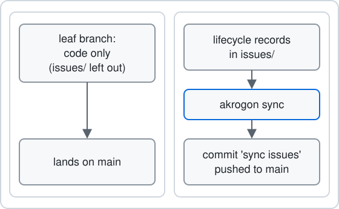

# Save records

Akrogon keeps two kinds of work apart. A leaf branch carries code only. Plans, reviews, state and logs under `issues/` are lifecycle records, and you save them with `akrogon sync` in the registered checkout.



## Why the two are apart

Agents change code in worktrees while you read and edit briefs in the main checkout. Records stay in one place on the default branch, and code follows its own review and merge path. A phase move refuses a leaf branch that changes files under `issues/`, with `Issue files on leaf branch belong in <leaf folder>`. See [phase.ts](../../src/phase.ts) `requireNoIssueFiles`.

## Run sync

From the registered checkout, on its default branch:

```sh
git status --short
akrogon sync
```

Sync does these steps in order:

1. Checks that you are on the configured default branch. Any other branch or a detached HEAD stops it with `Cannot sync from <branch>`.
2. Checks staged files. If anything staged is not an eligible record, it stops and lists those paths with `Cannot sync with staged paths outside eligible issue records`.
3. Fetches the configured remote's default branch.
4. Stages every changed, deleted or new eligible record and commits with the message `sync issues`. Nothing changed means no commit.
5. Rebases onto the fetched tip. Your other unstaged edits are set aside and put back.
6. Pushes to the configured remote's default branch.

If putting your edits back conflicts, sync stops before the push and lists the paths. Resolve them, then run `akrogon sync` again.

## What counts as a record

An eligible record is a file under `issues/` that is not:

- in `issues/seeds/`, which `akrogon pull` rewrites
- a `.lock` or `.closing` file
- a `*.tar.zst.tmp` file left by a pack in progress
- inside the worktree store, when that store sits inside the checkout

Files outside `issues/` are never records. That includes `learnings/LESSONS.md` and `learnings/history/`, which the skills leave for you to commit. See [sync.ts](../../src/sync.ts) `eligibleRecord` and [Files](../reference/files.md) for what each record is.

## Sync refuses

Fix the condition named in the message and run sync again.

- **Wrong branch.** Switch the registered checkout to its default branch.
- **Staged files outside records.** Run `git diff --cached --name-only`. Commit those files yourself, or unstage them with `git restore --staged <path>`.
- **Ignored files in the way.** `Cannot sync over ignored operator paths` means a git-ignored local file would be overwritten by the fetched tip or the rebase. Move or remove it.
- **Lock paths tracked or incoming.** Messages that name active coordination lock paths mean a lock file is tracked in git, arrives from the remote, or is touched by a local commit. Remove the listed paths from git, then sync.

## gacp, your own shortcut

Some readers keep a Bash function named `gacp` in their startup file. It is not part of Akrogon. It runs only on a branch named `main`, stages everything under the current folder with `git add .`, commits the whole index (including files you staged earlier) with your message or `add issues`, then runs `git pull --rebase --autostash origin main` and `git push origin main`.

Use sync for routine record saves. It picks only eligible records and uses the configured remote and branch. Use gacp only when you want to commit everything under the current folder in one ordinary commit, your project pushes to `origin/main`, and you have checked `git status --short` first. gacp does not know which files are records.

See [Commands](../reference/commands.md) for every command.

Next: [Files](../reference/files.md)
