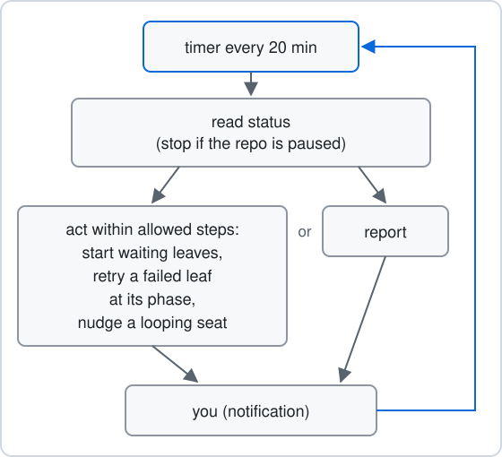

# Watch while you are away

Optional: the [watch-issues](../../skills/watch-issues/SKILL.md) skill checks every open leaf of one repository every 20 minutes while you step away. It works in claude, codex, pi and agy. You start it and you stop it. Your leaves run the same without it.

## Start the watch

Open your agent CLI — claude, codex, pi or agy — in an hc terminal of the session that holds the repository's space, in the registered repository, and send:

```text
watch-issues <root>
```

(Claude also accepts `/watch-issues`.) It runs one check right away and starts a timer terminal named `<prefix>-watch` in the same session, which sends a `watch-issues tick` line to your agent every 20 minutes. If a watch is already running, it reports it and starts no second one.

While the watcher is busy, the timer keeps the latest unsent tick. That tick runs one check when the watcher is idle. A prompt typed into the watcher terminal when a tick is due can receive the tick instead: claude and agy run the check inside that turn, and on codex the prompt's task is dropped and must be retyped.

## What each check does



1. It runs `observe.ts` once for the repository's pause state and each open leaf's phase, seats and failure record. It reports and stops if the repository is paused with `akrogon pause` or the read fails.
2. It starts leaves that wait on an idle seat with `akrogon next <slug>`, or `akrogon next --all` when several wait. It leaves a leaf alone while a leaf it is blocked by is not merged.
3. It retries a failed leaf at the phase where it failed with `akrogon phase <slug> <phase>` and `akrogon next <slug>`. It does this only when the leaf's seats are idle, and it gives up after two retries in a row that fail again.
4. It reads a busy seat's log and screen. If the seat repeats the same failing step, or works outside its brief, the check stops it once and sends one correcting prompt. A slow command alone is not a reason to step in.
5. It sends a notice that herdr-app shows as a toast when a leaf needs you, then replies with a few lines on what it saw and did.

## What stays yours

The watch now consults and recovers on its own: a failure it cannot retry starts a consultant, a peer agent the watch exchanges case files with, and a verified fix resumes the leaf without you. What it stops for and brings to you is the stop list: a credential, login, grant or permission; a change to a decision or lock you made; host tooling installs or downgrades; a force push or history rewrite; and a fix that would change what was decided. Stopping the watch itself is yours too.

The watch still never kills an agent, kills or removes a terminal other than the timer and its own consultant, answers a leaf seat, or edits `state.yaml`, worktrees or `issues/`.

## Stop the watch

Stop it from any terminal of the session, in the watching agent or another one, with:

```text
watch-issues stop <root>
```

(Claude also accepts `/watch-issues stop`.) The watch also ends when the agent exits, when its terminal finishes or is reused, and when claude or agy shows a `/clear` reset. Codex and pi `/new` may leave the watch running into the new conversation. The first tick attempts to stop it. A compaction summary before a tick keeps the watch running, as does having no open leaves.

If you exit a shell-launched agent right as a tick goes out — with or without a held draft — the tick can reach the shell or a program you start there. A replacement agent running `watch-issues` refuses the tick when its process ID differs.

Next: [Commands](../reference/commands.md)
