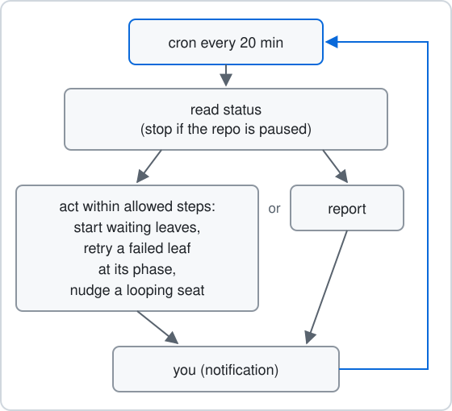

# Watch while you are away

Optional: the [watch-issues](../../skills/watch-issues/SKILL.md) skill checks every open leaf of one repository every 20 minutes while you step away. You start it and you stop it. Your leaves run the same without it.

## Start the watch

Optional: open Claude Code in the registered repository and run:

```text
/watch-issues
```

It runs one check right away. Then it creates one Claude Code cron job that repeats the check every 20 minutes and prints the job id and its 7-day expiry. If a watch job already exists, it reports that job and creates no second one. The watch needs Claude Code cron, so it does not run in other agent CLIs.

## What each check does



1. It runs `akrogon status`. If the repository is paused with `akrogon pause`, the check does nothing else.
2. It reads each open leaf's phase, seats and failure record.
3. It starts leaves that wait on an idle seat with `akrogon next <slug>`, or `akrogon next --all` when several wait. It leaves a leaf alone while a leaf it is blocked by is not merged.
4. It retries a failed leaf at the phase where it failed with `akrogon phase <slug> <phase>` and `akrogon next <slug>`. It does this only when the leaf's seats are idle, and it gives up after two retries in a row that fail again.
5. It reads a busy seat's log and screen. If the seat repeats the same failing step, or works outside its brief, the check stops it once and sends one correcting prompt. A slow command alone is not a reason to step in.
6. It sends you a Herdr notification when a leaf needs you, then replies with a few lines on what it saw and did.

## What stays yours

The watch never recovers a leaf that failed on a credential, a permission, a decision or an outside step. It notifies you instead. Fix the cause, then move the leaf yourself as shown in [Limits](../reference/limits.md).

The watch never kills an agent, closes a pane, answers a seat, or edits `state.yaml`, worktrees or `issues/`.

## Stop the watch

Optional: stop it with:

```text
/watch-issues stop
```

The job also ends when the Claude Code session ends or the 7-day expiry passes. It never stops itself, even when no open leaves are left.

Next: [Commands](../reference/commands.md)
