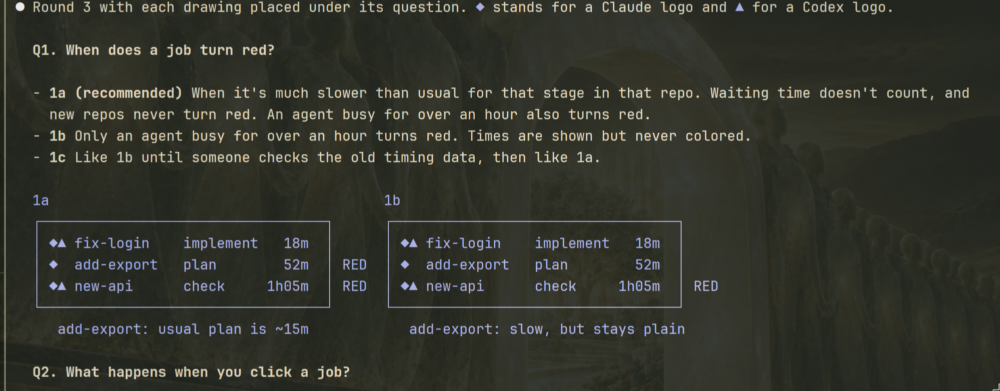

# Intake: round-drawings

## Scope

akrogon, from Tamdoma/akrogon#125. Destination and grouping are set by the opening map.

## Provenance

- GitHub: Tamdoma/akrogon#125
- Operator: door pane t15, 2026-11-04 (switch-on words below)

## Source: Tamdoma/akrogon#125

# Chart rounds: a drawing under a question makes UI decisions easier to choose

Source: Tamdoma/akrogon#125
URL: https://github.com/Tamdoma/akrogon/issues/125

Origin repo: Tamdoma/akrogon

Unverified intake.

## Observation

During chart-issues round 3 of the herdr-panels chart (Tasks panel, 2026-11-03), the operator asked to see an ASCII drawing for each option before answering, and then for the drawings to be placed directly under each question's options. The operator said this made the choices much easier to understand and choose between.

The operator's rule for this: show drawings or diagrams only where they make the operator's decision much easier. The fork still has to carry every element the round format requires (opening paragraph, research line, labelled recommendation, how-to-choose, pitfalls avoided, reply key, challenge check).

Reference screenshot of the blended round (question, options, then side-by-side drawings of 1a and 1b):

## Location

chart-issues door, operator rounds: `skills/chart-issues/assets/questions.md`, section "Operator questions and peer exchange" (round shape).

## Reproduction

Present a round whose options differ in layout or visible behavior (for example a UI panel: when a row turns red, what a click opens, whether a panel opens by itself). With text alone, the operator asked for drawings before answering.

## Expected behavior

When a question's options differ in something visible (layout, screen states, flow), the round can show a small drawing per option under that question, in the same round, so the operator can compare them at a glance. Questions where a drawing does not help get none. All other required round parts stay.

## Urgency

Low. Workaround: the operator asks for drawings, and the door redraws the round. That costs one extra exchange per round.

## Suspected cause

The round shape in `skills/chart-issues/assets/questions.md` ("Operator questions and peer exchange") lists text parts only: question sentences, research line, options, how-to-choose, pitfalls avoided, reply key, challenge check. It allows "a concrete example where needed" but does not mention a visual comparison of options, so the door does not offer one.
Whose view: agent.
Files read: `skills/chart-issues/assets/questions.md` (repo source, sections "Operator questions and peer exchange" and "Research").
Not inspected: other skills' round formats; whether the questions.md line budget or tests pin the round shape.
Related reports: none found (Tamdoma/akrogon, state all, `--author @me` created in the last two days, and the search "operator round drawing", limits 30 and 10).

## Source: operator t15 2026-11-04

"I just pulled the 3 issues. We're gonna do autopilot mode with manual signposts. Use slot b (codex) and slot c (claude code fable 5.1 high reasoning) consultants."

"This is the new herdr-app that I'm going to be updating. Please look at the herdr-app issue, and also Read ~/.config/herdr-app/AGENTS.md. We'll be moving to this architecture soon, but not right now."

## Agent findings

none yet
